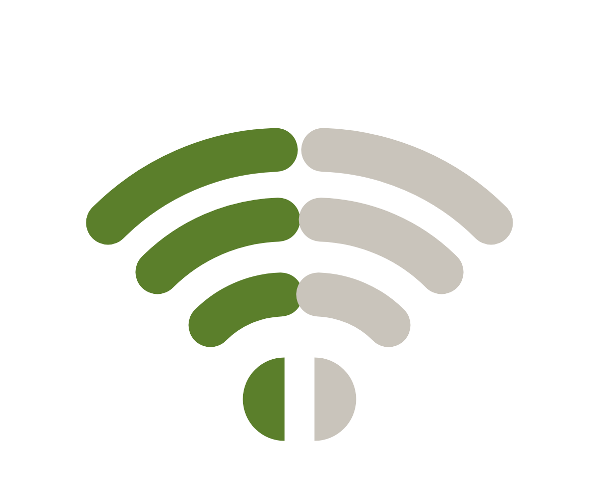
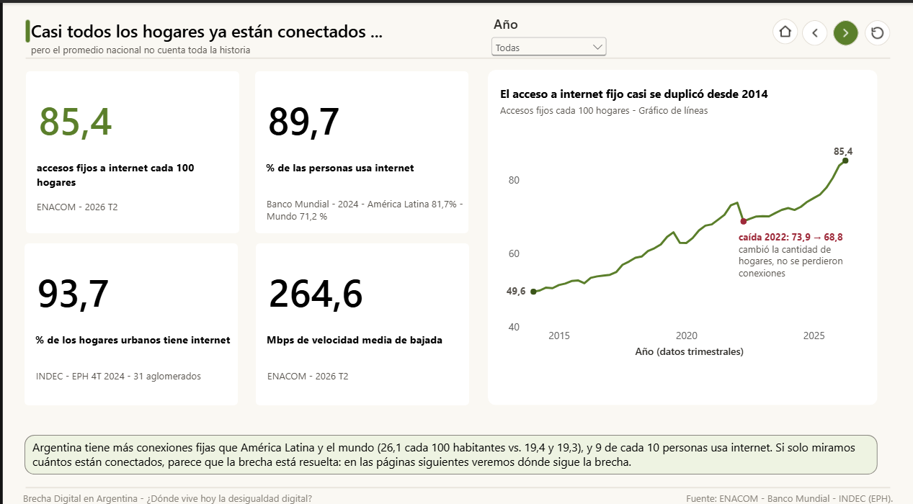
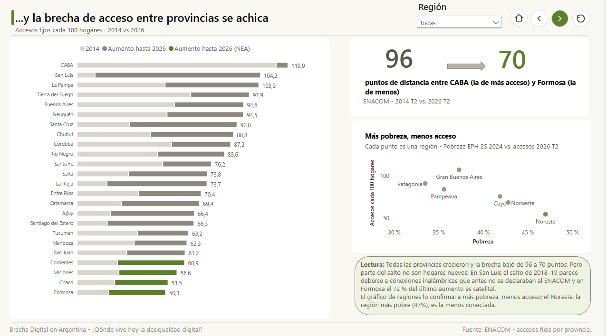
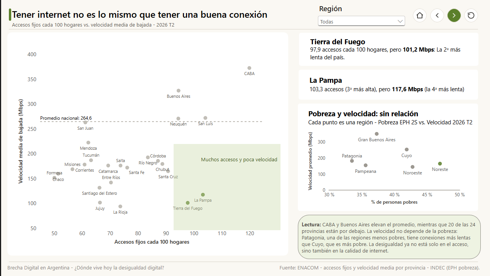
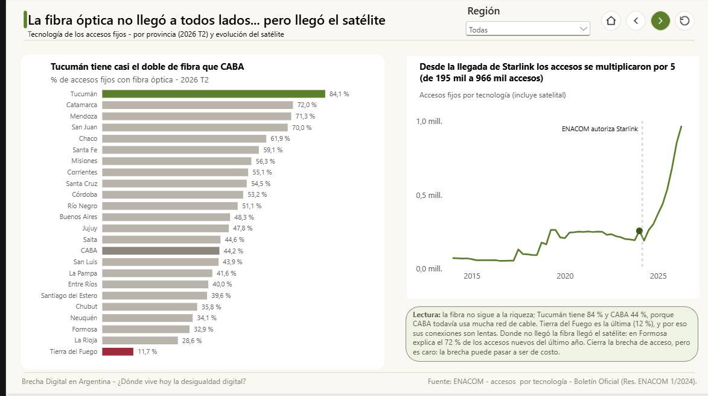
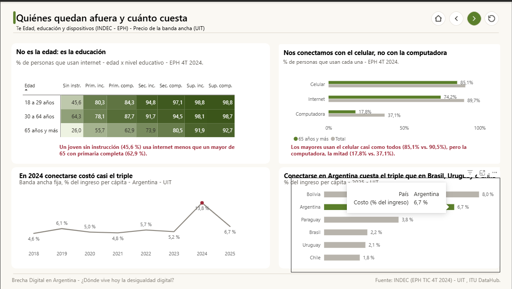
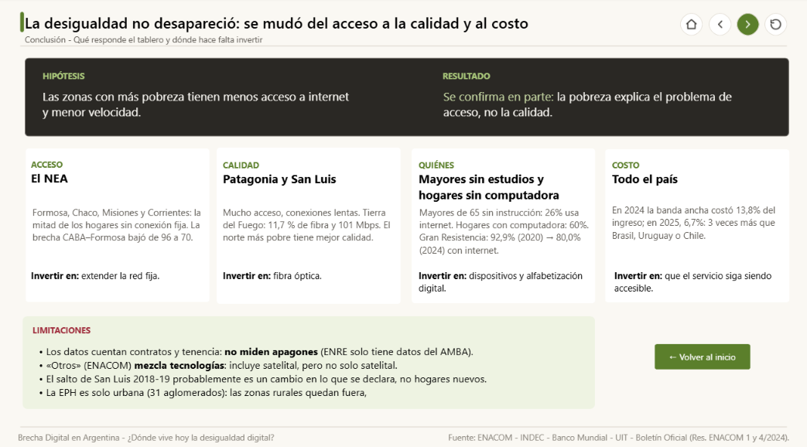

<p align="center">
  
</p>

<h1 align="center">Brecha Digital en Argentina</h1>

<p align="center"><b>¿Dónde vive hoy la desigualdad digital?</b></p>

Tablero de Power BI que analiza el acceso, la calidad, la tecnología y el costo de la internet fija en las 24 jurisdicciones de Argentina, entre 2014 y 2026, usando solo fuentes oficiales.

- **Autora:** Jordana Elizabeth Escalona Colivoro
- **Contexto:** Tecnicatura Superior en Ciencia de Datos e IA (Centro Politécnico Superior Malvinas Argentinas) · Concurso Contar con Datos
- **Herramienta:** Power BI Desktop

## Hipótesis

Las zonas más pobres tienen menos acceso a internet y conexiones más lentas.

**Resultado:** se cumple para el acceso, pero no para la velocidad. La desigualdad no desapareció: se mudó del acceso a la calidad y al costo.

## Hallazgos

> **Gran idea:** en Argentina casi todos los hogares ya pueden conectarse, pero la desigualdad no desapareció: se mudó del acceso a la calidad y al costo. Si solo medimos cuántos están conectados, vamos a creer que la brecha está resuelta cuando no lo está.

### 1. Conectados: el acceso casi se duplicó
- Los accesos fijos cada 100 hogares pasaron de **49,6 (2014) a 85,4 (2026 T2)**.
- La "caída" de 2022 no fue real: cambió el denominador (la cantidad de hogares estimada), no la cantidad de conexiones.
- En la pandemia las conexiones crecieron casi el doble que antes y después (+19,3 % entre 2019 y 2021, contra +11,7 % y +10,1 %). Los datos no dicen por qué: puede ser teletrabajo, clases virtuales o trámites online.

*Fuente: ENACOM.*

### 2. Acceso: la brecha se achica y sigue a la pobreza
- La diferencia entre CABA y Formosa bajó de **96 a 70 puntos** (2014 → 2026).
- Por región, a más pobreza, menos acceso. El Noreste, con la pobreza más alta (47 %), es la región con menos accesos (54,8 cada 100 hogares).
- Gran Buenos Aires es la excepción: tiene pobreza media pero el mayor acceso, porque incluye a CABA (119,9).
- **Dato que no se ve:** un número no siempre es un cambio en la realidad. San Luis pasó de 15 a 85 accesos cada 100 hogares entre 2017 y 2019. Parece deberse a conexiones inalámbricas que antes no se declaraban al ENACOM, no a hogares nuevos (no confirmado).

*Fuentes: ENACOM; INDEC, EPH 2º semestre 2024.*

### 3. Calidad: la pobreza no ordena la velocidad
- Solo **4 de las 24 jurisdicciones** superan la velocidad media nacional de 264,6 Mbps (CABA, Buenos Aires, San Luis y Neuquén). El promedio pesa por cantidad de conexiones, y el AMBA concentra la mayoría.
- CABA tiene casi **4 veces** la velocidad de La Rioja (372,4 contra 93,9 Mbps).
- **Paradoja:** Tierra del Fuego y La Pampa están entre las de más acceso, pero entre las más lentas.
- Cuyo, con 41,9 % de pobreza, es la segunda región más rápida. Pampeana y Patagonia, las menos pobres, están entre las más lentas.
- La pobreza explica el acceso; la calidad sigue al mapa de la infraestructura.
- San Luis tiene una velocidad media alta, pero es la provincia con menos conexiones de más de 30 Mbps (52,7 %). Un promedio alto puede esconder hogares mal conectados.

*Fuentes: ENACOM, 2026 T2; INDEC, EPH.*

### 4. Tecnología: la fibra no sigue a la riqueza
- **Tucumán** tiene el 84,1 % de sus accesos con fibra óptica (1ª del país). **CABA** tiene 44,2 %, porque más de la mitad de sus accesos siguen siendo de cable: tendió su red antes. **Tierra del Fuego** tiene 11,7 % (última), y eso ayuda a explicar su baja velocidad.
- Los accesos que ENACOM clasifica como «Otros» (incluye satelital) pasaron de **194.796 a 965.634** entre fines de 2023 y 2026 T2: casi 5 veces más.
- El salto coincide con la autorización de servicios satelitales (Res. ENACOM 1/2024 y 4/2024, Boletín Oficial).
- En Formosa y Tierra del Fuego, «Otros» ya es el 27,8 % de los accesos.

*Fuentes: ENACOM; Boletín Oficial.*

### 5. Quiénes quedan afuera: no es la edad, es la educación
- Los mayores de 65 fueron el grupo que más creció en uso de internet (55,2 % → 74,2 %, 2020-2024), pero siguen siendo los más rezagados.
- Dentro de los mayores de 65, la educación abre una brecha de **67 puntos**: sin instrucción usa internet el 26,0 %, con superior completa el 92,7 %.
- **Dato que no se ve:** un joven de 18 a 29 sin instrucción (45,6 %) usa internet menos que un mayor de 65 con primaria completa (62,9 %).
- Los chicos de 4 a 12 años son el único grupo cuyo uso bajó (82,8 % → 79,0 %).
- En los hogares, internet sube y la computadora baja (computadora: 64 % → 60 %). La conectividad se volvió "de bolsillo".
- En Gran Resistencia (Chaco), el aglomerado con más pobreza (60,8 %), los hogares con internet cayeron de 92,9 % a 80,0 % (2020-2024) mientras el país subía. Ahí la brecha se está abriendo.

*Fuente: INDEC, EPH – Acceso y uso de TIC, 4T 2020, 2023 y 2024 (datos de encuesta por muestra).*

### 6. Costo: conectarse se volvió mucho más caro
- En 2024 la banda ancha fija costó el **13,8 % del ingreso per cápita** en Argentina, cuando antes rondaba el 5 %.
- Ese mismo año, los precios de Comunicación subieron 186,4 % interanual, contra 117,8 % del nivel general (IPC, diciembre 2024).
- Argentina conecta más que el promedio de América Latina (89,7 % de usuarios de internet contra 81,7 %, 2024), pero paga mucho más: en 2024 fue el país más caro de la región, y en 2025 (6,7 %) pagó unas 3 veces más que Brasil, Uruguay o Chile.

*Fuentes: UIT; INDEC, IPC; Banco Mundial.*

El detalle completo, con cálculos, notas metodológicas y pendientes de verificación, está en [`datos/documentacion/hallazgos.txt`](datos/documentacion/hallazgos.txt).

## Estructura del tablero

| Página | Contenido |
|---|---|
| Portada | Pregunta y navegación |
| 1. Conectados | Evolución nacional del acceso |
| 2. Acceso | Accesos por provincia y pobreza por región |
| 3. Calidad | Velocidad por provincia y pobreza por región |
| 4. Tecnología | Fibra óptica y otras tecnologías |
| 5. Quiénes y costo | Uso por edad y nivel educativo; costo vs. países de la región |
| 6. Conclusión | Gran idea y datos que no se ven |

## Vista del tablero

**1. Conectados**



**2. Acceso**



**3. Calidad**



**4. Tecnología**



**5. Quiénes y costo**



**6. Conclusión**



## Estructura del repositorio

```
BrechaDigital/
├── datos/
│   ├── argentina/        ENACOM (accesos, velocidad, tecnologías) y provincias
│   ├── mundo/            Banco Mundial y UIT
│   ├── social/           INDEC: EPH, Censo 2022, IPC
│   └── documentacion/    hallazgos, registro de fuentes, diccionario DAX, informes INDEC
├── imagenes/          logo y capturas del tablero
├── powerbi/
│   ├── brecha_digital.pbix
│   └── recursos/         tema de colores, íconos, fondos y bocetos del diseño
├── README.md
├── LICENSE
└── CHANGELOG.md
```

La organización sigue la idea de plantillas como *cookiecutter data science*: datos crudos separados por fuente, documentación aparte y el reporte en su propia carpeta.

## Fuentes

Solo fuentes oficiales. El detalle (URL, fecha de descarga, período y notas) está en [`datos/documentacion/registro_fuentes.txt`](datos/documentacion/registro_fuentes.txt).

- **ENACOM** – Datos abiertos de internet fija (accesos, velocidad, tecnologías).
- **INDEC** – EPH (pobreza y acceso/uso de TIC), Censo 2022, IPC.
- **Banco Mundial** – Banda ancha fija y usuarios de internet.
- **UIT** – Precio de la banda ancha fija como % del ingreso.
- **Boletín Oficial** – Resoluciones ENACOM 1/2024 y 4/2024 (servicio satelital).

## Cómo abrir el proyecto

1. Descargá o cloná el repositorio.
2. Abrí `powerbi/brecha_digital.pbix` con Power BI Desktop (gratuito).
3. Si Power BI no encuentra los datos, andá a **Transformar datos → Configuración de origen de datos** y cambiá la ruta a la carpeta `datos/` de tu computadora.

## Documentación

- [`hallazgos.txt`](datos/documentacion/hallazgos.txt): hallazgos, notas metodológicas y decisiones de diseño.
- [`registro_fuentes.txt`](datos/documentacion/registro_fuentes.txt): de dónde sale cada archivo.
- [`diccionario_medidas_dax.txt`](datos/documentacion/diccionario_medidas_dax.txt): cada medida DAX y columna calculada, con su fórmula y para qué sirve.

## Limitaciones

- No hay datos oficiales que midan cortes de servicio o apagones.
- La categoría «Otros» de ENACOM mezcla tecnologías (entre ellas, satelital).
- La EPH cubre solo aglomerados urbanos; las regiones son una aproximación a las provincias.
- Relacionar pobreza y conectividad muestra correlación, no causalidad.

## Próximos pasos

Los pendientes están cargados como [issues](../../issues) del repositorio.

## Licencia

El análisis, el tablero y la documentación se publican bajo [CC BY 4.0](https://creativecommons.org/licenses/by/4.0/deed.es). Los datos pertenecen a cada organismo y conservan sus propios términos de uso. Ver [`LICENSE`](LICENSE).
